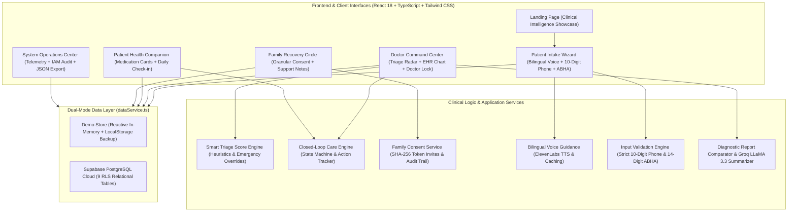

# PulseBridge AI — Clinical Intelligence & Care-Coordination Platform

[](https://github.com/vaishnavijha006-hub/PulseBridge)
[](https://github.com/vaishnavijha006-hub/PulseBridge)
[](https://github.com/vaishnavijha006-hub/PulseBridge)
[](https://vercel.com/vaishnavijha006-3492s-projects/pulse-bridge)
[](LICENSE)

> **PulseBridge AI** is an enterprise-grade clinical intelligence and care-coordination platform designed to bridge communication gaps among doctors, patients, and family caregivers during post-consultation recovery. It transforms static prescription papers and laboratory pathology reports into active, closed-loop recovery workflows with bilingual voice guidance, smart triage prioritization, and patient-controlled family circles.

---

## Live Links & Repositories

| Environment | URL / Destination | Description |
| :--- | :--- | :--- |
| 🚀 **Live Production App (Vercel)** | [https://pulse-bridge-three.vercel.app](https://pulse-bridge-three.vercel.app) *(or your assigned Vercel domain)* | Live web deployment on Vercel Edge Network |
| ⚡ **Vercel Project Dashboard** | [vercel.com/vaishnavijha006-3492s-projects/pulse-bridge](https://vercel.com/vaishnavijha006-3492s-projects/pulse-bridge) | Deployment management, logs & environment variables |
| 💻 **GitHub Repository** | [github.com/vaishnavijha006-hub/PulseBridge](https://github.com/vaishnavijha006-hub/PulseBridge) | Complete source code, branch history & CI workflows |
| 🛠️ **Local Development** | `http://localhost:5173` | Run `npm run dev` locally |

---

## The Clinical Problem & The PulseBridge Solution

### The Challenge: Post-Consultation Care Drop-Off
In modern outpatient healthcare, up to **50% of medication adherence failures** and avoidable hospital readmissions happen after the patient leaves the clinic. Patients struggle with illegible handwritten prescriptions, complex dosage schedules, unaddressed side effects, and lack of family visibility. Simultaneously, physicians lack real-time visibility into post-discharge recovery gaps.

### The PulseBridge Solution
PulseBridge creates a **closed-loop feedback circle**:
1. **Intake & OCR Ingestion**: Patients digitize prescriptions via OCR with strict input validation (10-digit mobile, optional ABHA format check) and bilingual voice assistance.
2. **Physician Review & Lock**: Doctors verify OCR extractions with "Doctor Lock" safeguards, assess clinical triage priority scores, and publish authoritative medication schedules.
3. **Patient Health Companion**: Patients receive dynamic schedule cards with gentle 20-minute grace windows, daily adherence tracking, and plain-language report summaries.
4. **Consent-Based Family Recovery Circle**: Patients selectively share recovery milestones with loved ones through cryptographic invitations and granular, real-time revocable permissions.
5. **Closed-Loop Action Engine**: Physicians and care teams track open clinical follow-ups and care gaps to deterministic resolution with mandatory clinical outcome documentation.

---

## System Architecture



---

## End-to-End User Workflows

### 1. Patient Intake & Smart Ingestion Workflow
- **Language Selection**: Seamless switching between **English** and **Hindi (हिंदी)** with persistent browser memory.
- **Bilingual Voice Guidance**: ElevenLabs integration reads out step-by-step instructions with audio caching and accessibility attributes.
- **Demographic & Phone Validation**: Enforces strict **10-digit numeric mobile number** validation (`src/utils/phone.ts`). Strips country code (`+91`), trunk prefixes (`0`), and formatting dashes while blocking invalid lengths.
- **Truthful ABHA Support**: Allows entering optional 14-digit Ayushman Bharat Health Account IDs. Normalizes format (`XX-XXXX-XXXX-XXXX`) and marks status as `unverified` without falsely claiming live ABDM gateway verification.
- **Prescription Ingestion**: Patients photograph their physical prescription slip for secure cloud OCR processing.

### 2. Doctor Clinical Review & Closed-Loop Care Plan Confirmation
- **Clinical Command Center**: Collapsible navigation with real-time badges for urgent triage alerts, open care gaps, and pending prescription drafts.
- **Smart Triage Radar**: Calculates priority scores (0–100) using 5 heuristic dimensions:
  - Severity of symptoms reported
  - Medication adherence history
  - Missed dose frequency
  - Follow-up question delays
  - Diagnostic test abnormalities
- **Emergency Safety Override**: Severe symptoms (e.g., chest pain, respiratory distress) or critical drug-allergy interactions immediately lock the patient to **URGENT** priority with an un-dismissible clinical banner.
- **OCR Verification & Doctor Lock**: Physicians review AI-extracted medication lines, edit dosages, and explicitly click "Confirm Care Plan". Unconfirmed prescriptions cannot be assigned to patients.
- **Medication Schedule Generation**: Confirmed care plans automatically populate the patient's companion schedule with accurate morning, afternoon, evening, and bedtime time-slots.

### 3. Patient Recovery Companion Workflow
- **Reassuring Personal Hero**: Warm greeting displaying daily medication completion percentage and next upcoming dose.
- **Gentle Grace Period Notice**: Explains the 20-minute gentle grace window for scheduled doses.
- **Dose Cards**: High-contrast interactive cards allowing patients to mark doses as **Taken**, **Snooze (10 mins)**, or **Cannot Take** (with structured reason recording).
- **Daily Health Check-in**: Expressive feeling buttons (Feeling Good, Okay, Unwell) providing instant feedback and feeding back into doctor triage heuristics.
- **Medical Reports & Plain-Language Summaries**: Explains laboratory pathology findings without intimidating medical jargon.

### 4. Consent-Based Family Recovery Circle Workflow
- **Patient-Controlled Privacy**: Patients invite loved ones using unique 7-day cryptographic tokens bound to the recipient's email address.
- **Granular Category Toggles**: Patients independently toggle what each family member can view:
  - `shareProfile` (Basic patient identity)
  - `shareMedicationStatus` (Doses taken today, next dose time)
  - `shareDailyVitals` (High-level recovery status)
  - `shareAppointments` (Doctor consultations & follow-ups)
  - `shareCareInstructions` (Dietary guidelines & recovery tips)
  - `shareCareActions` (Permitted recovery milestones)
  - `allowDirectCalling` (Direct phone calling button)
- **Immediate One-Click Revocation**: Revoking access cuts off future reads fail-closed immediately.
- **Immutable Audit Trail**: Append-only log recording every invite, permission toggle, and revocation.
- **Family Portal**: Family members view a non-alarming timeline and send warm encouragement notes.

### 5. System Operations Center (Admin)
- **Infrastructure Telemetry**: Real-time connectivity telemetry for database, edge functions, and object storage.
- **Role & Access Directory**: Transparent table of personas (`Dr. S. Sharma`, `Ravi Sharma`, `Priya Daughter`, `System Admin`).
- **Security & RLS Catalog**: Verification of Row-Level Security across 9 PostgreSQL tables.
- **One-Click Telemetry Export & Demo Store Re-seed**: Diagnostic JSON export and certified demo action store re-seeding.

---

## Closed-Loop Care Action Tracking & State Machine

```
              ┌───────────────────────────────────┐
              │                                   ▼
    [ open ] ───► [ in_progress ] ─────────► [ resolved ]
       │              │                           │
       │              ▼                           │ (reopen with justification)
       └───────► [ documented ]                   ▼
                      │                    [ in_progress ]
                      └───────────────────────────┘
```

1. **`open`**: Action identified; work not yet started. Every action strictly defaults to `open`.
2. **`in_progress`**: Care team member is actively working on the intervention.
3. **`resolved`**: Intervention complete with a verified clinical outcome.
   - **Validation Rule**: Transition to `resolved` strictly requires a meaningful, non-empty `outcomeNote`. Submissions without an outcome note are rejected.
   - Re-opening a `resolved` action back to `in_progress` requires an explicit clinical justification (`reopenJustification`).
4. **`documented`**: Clinical decision or interim finding recorded (`documentedDecision`), but the underlying condition remains **unresolved** for ongoing monitoring.
5. **Overdue Detection**: Actions with a `dueDate` prior to the current timestamp that are not resolved are flagged with high-visibility **OVERDUE** alerts.

---

## Verified Feature Branches in `main`

All 6 primary feature branches are unified into `main` with zero merge conflicts:

| Branch Name | Primary Capability Integrated | Ancestry Status |
| :--- | :--- | :---: |
| **`main`** | Unified clinical platform, premium homepage redesign | `HEAD` |
| **`feature/closed-loop-care`** | 6-feature closed-loop care engine, CareGap radar, prescription scanner | ✅ Merged |
| **`feature/consent-family-recovery-circle`** | Patient consent center, family companion portal, granular permissions | ✅ Merged |
| **`feature/premium-ui-redesign`** | Clinical Command Center, Personal Companion, System Ops redesign | ✅ Merged |
| **`feature/secure-ai-report-summarization`** | Edge AI summarization with Groq LLaMA 3.3 70B, doctor lock | ✅ Merged |
| **`feature/report-summary-mvp`** | Safe diagnostic report parsing, lab findings comparison | ✅ Merged |

---

## Live Quality Assurance & Verification Report

*Commit: [`36eb03a`](https://github.com/vaishnavijha006-hub/PulseBridge/commit/36eb03a) | Automated Test Run Status: 100% Passing*

### Test Suite Execution
```bash
npm test -- --run
```
- **Test Files**: **13 passed (13 of 13 suites)**
- **Total Tests**: **188 passed | 10 skipped | 0 failed (198 tests)**
- **Execution Time**: ~13.32s

| Test Suite File | Tests Passed | Status | Coverage Scope |
| :--- | :---: | :---: | :--- |
| `src/services/familyConsentService.test.ts` | **15** | ✅ Passed | Invitations, permissions, token hashing, audit log |
| `src/services/careActionService.test.ts` | **44** | ✅ Passed | Lifecycle state machine, validation, overdue calculation |
| `src/services/familyConsentAuthorization.test.ts` | **54** | ✅ Passed (10 skip)* | Granular permission boundary, email-token binding, fail-closed access |
| `src/services/voiceGuidanceService.test.ts` | **8** | ✅ Passed | ElevenLabs speech synthesis, rate limits, audio caching |
| `src/pages/DoctorToPatientWorkflow.test.tsx` | **6** | ✅ Passed | End-to-end doctor review, care-plan update, patient sync |
| `src/pages/AbhaIntegration.test.tsx` | **12** | ✅ Passed | ABHA format validation, unverified tagging, intake flow |
| `src/pages/PhoneValidation.test.tsx` | **7** | ✅ Passed | Strict 10-digit phone intake validation, bilingual error states |
| `src/utils/phone.test.ts` | **16** | ✅ Passed | Phone normalization (+91, trunk 0), 10-digit rule |
| `src/components/ClosedLoopCareView.test.tsx` | **5** | ✅ Passed | Closed-loop UI components, filter tabs, outcome modals |
| `src/components/VoiceGuidanceControl.test.tsx` | **7** | ✅ Passed | Bilingual speech playback, accessibility attributes |
| `src/pages/PatientContextContinuity.test.tsx` | **5** | ✅ Passed | Intake-to-dashboard identity continuity, demo fallback |
| `src/pages/FamilyRecoveryCircle.test.tsx` | **12** | ✅ Passed | Family portal, timeline updates, notes, consent UI |
| `src/pages/Dashboards.test.tsx` | **7** | ✅ Passed | Admin System Ops, Doctor Command Center, patient triage |
| **Total** | **188 passed** | ✅ **All Pass** | *(10 database-level RLS skipped for live Supabase testing)* |

### TypeScript Strict Compilation
```bash
npx tsc --noEmit -p tsconfig.app.json
```
- **Exit Code**: `0` (Zero compiler warnings or type errors across the entire codebase).

### Production Build Metrics
```bash
npm run build
```
- **Build Time**: `6.84s`
- `dist/index.html`: `0.73 kB` (gzip: `0.40 kB`)
- `dist/assets/index.css`: `62.59 kB` (gzip: `10.92 kB`)
- `dist/assets/index.js`: `768.50 kB` (gzip: `193.74 kB`)

---

## Tech Stack & Dependencies

- **Frontend Framework**: React 18.3 with TypeScript (Vite 5 bundler)
- **Styling & Tokens**: Tailwind CSS 3.4 with custom clinical navy/teal/cyan palette
- **Icons**: Lucide React
- **Voice Synthesis**: ElevenLabs Text-to-Speech API integration with localized phonetic support
- **AI Processing**: Groq LLaMA 3.3 70B Versatile for safe clinical report summarization
- **Database & Auth (Dual Mode)**: Supabase PostgreSQL Cloud with Row Level Security (RLS) & local reactive demo store
- **Testing**: Vitest 2.1, React Testing Library, jsdom

---

## Local Development & Setup

### Prerequisites
- Node.js 18+
- npm 9+

### Quickstart
```bash
# 1. Clone repository
git clone https://github.com/vaishnavijha006-hub/PulseBridge.git
cd PulseBridge

# 2. Install dependencies
npm install

# 3. Start local development server (port 5173)
npm run dev

# 4. Run test suite
npm test -- --run

# 5. Typecheck codebase
npx tsc --noEmit -p tsconfig.app.json

# 6. Build production bundle
npm run build
```

---

## Environment Variables Configuration

Copy `.env.example` to `.env` if connecting to live cloud services:


*Note: If environment variables are omitted, PulseBridge AI automatically operates in fully functional, interactive Demo Mode.*

---

## License

This project is licensed under the [MIT License](LICENSE).
