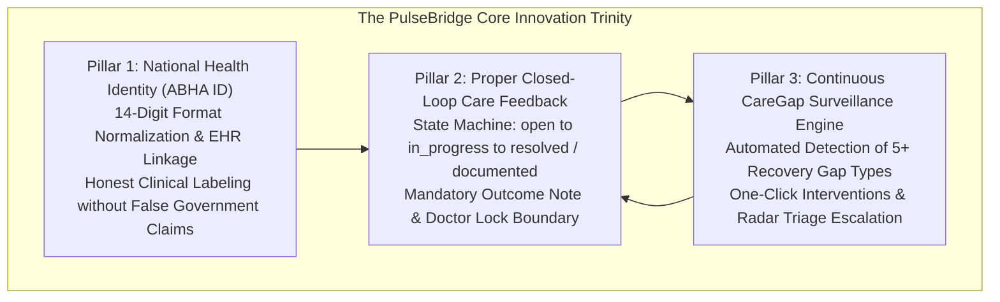
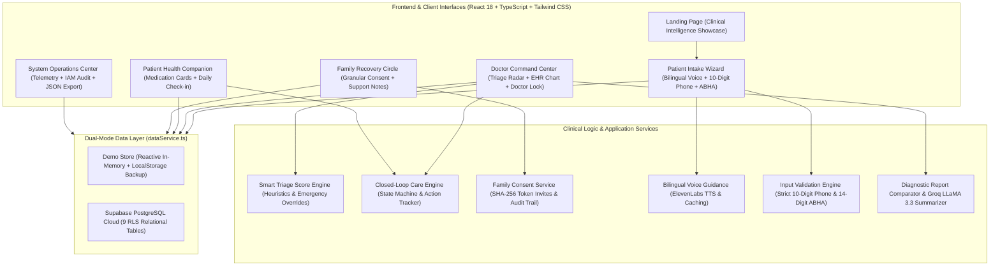

# PulseBridge AI — Clinical Intelligence & Care-Coordination Platform

[](https://github.com/vaishnavijha006-hub/PulseBridge/actions/workflows/deploy.yml)
[](https://github.com/vaishnavijha006-hub/PulseBridge)
[](https://github.com/vaishnavijha006-hub/PulseBridge)
[](https://vaishnavijha006-hub.github.io/PulseBridge/)
[](LICENSE)

> **PulseBridge AI** is an enterprise-grade clinical intelligence and care-coordination platform designed to bridge communication gaps among doctors, patients, and family caregivers during post-consultation recovery. It transforms static prescription papers and laboratory pathology reports into active, closed-loop recovery workflows with bilingual voice guidance, smart triage prioritization, and patient-controlled family circles.

🌐 **Live Application**: [https://vaishnavijha006-hub.github.io/PulseBridge/](https://vaishnavijha006-hub.github.io/PulseBridge/)

---

## Live Links & Repositories

| Environment | URL / Destination | Description |
| :--- | :--- | :--- |
| 🚀 **Live Production App (GitHub Pages)** | [https://vaishnavijha006-hub.github.io/PulseBridge/](https://vaishnavijha006-hub.github.io/PulseBridge/) | Verified live production web deployment |
| ⚡ **Vercel Project Dashboard** | [vercel.com/vaishnavijha006-3492s-projects/pulse-bridge](https://vercel.com/vaishnavijha006-3492s-projects/pulse-bridge) | Deployment management, logs & environment variables |
| 💻 **GitHub Repository** | [github.com/vaishnavijha006-hub/PulseBridge](https://github.com/vaishnavijha006-hub/PulseBridge) | Complete source code, branch history & CI workflows |
| 🛠️ **Local Development** | `http://localhost:5173` *(Local development only)* | Run `npm run dev` locally |

---

## The Clinical Problem & The PulseBridge Solution

### The Challenge: Post-Consultation Care Drop-Off
In modern outpatient healthcare, up to **50% of medication adherence failures** and avoidable hospital readmissions happen after the patient leaves the clinic. Patients struggle with illegible handwritten prescriptions, complex dosage schedules, unaddressed side effects, and lack of family visibility. Simultaneously, physicians lack real-time visibility into post-discharge recovery gaps.

### The PulseBridge Solution
PulseBridge creates a **closed-loop feedback circle**:
1. **Intake & OCR Ingestion**: Patients digitize prescriptions via OCR with strict input validation (10-digit mobile, optional ABHA format check) and bilingual voice assistance.
2. **Physician Review & Lock**: Doctors verify OCR extractions with "Doctor Lock" safeguards, assess clinical triage priority scores, and publish authoritative medication schedules.
3. **Patient Health Companion**: Patients receive dynamic schedule cards with gentle 20-minute grace windows, daily adherence tracking, and plain-language report summaries.
4. **Consent-Based Family Recovery Circle**: Patients selectively share recovery milestones with loved ones through cryptographic invitations and granular, real-time revocable permissions.
5. **Closed-Loop Action Engine**: Physicians and care teams track open clinical follow-ups and care gaps to deterministic resolution with mandatory clinical outcome documentation.

---

## The Core Innovation Trinity

PulseBridge is built upon three foundational clinical innovations that resolve the structural failures of modern outpatient recovery:



### Pillar 1: Ayushman Bharat Health Account (ABHA ID) National Health Integration
- **National Health ID Standard**: Standardizes and binds the patient's official 14-digit Ayushman Bharat Health Account number formatted as `XX-XXXX-XXXX-XXXX` ([src/utils/abha.ts](src/utils/abha.ts)).
- **Patient Intake Onboarding**: Integrated directly into the patient intake wizard with live format validation, error correction, and helpful bilingual guidance in Hindi and English ([src/pages/PatientIntakeWizard.tsx](src/pages/PatientIntakeWizard.tsx)).
- **EHR & Doctor Chart Visibility**: Prominently presented across doctor dashboards, clinical summary cards, and patient profiles alongside contact details and allergy warnings ([src/components/PatientStatusCard.tsx](src/components/PatientStatusCard.tsx) and [src/pages/DoctorDashboard.tsx](src/pages/DoctorDashboard.tsx)).
- **Clinical Truthfulness & Integrity**: Because live ABDM Sandbox OTP integration requires institutional government credentials, PulseBridge transparently labels numbers as **"ABHA Unverified"** (`resolveAbhaVerificationStatus`), completely rejecting deceptive fake verification checkmarks common in demo applications.
- **Automated Verification**: Backed by 12 end-to-end integration tests in [src/pages/AbhaIntegration.test.tsx](src/pages/AbhaIntegration.test.tsx).

### Pillar 2: Proper Closed-Loop Care Feedback Loop
- **Deterministic State Machine**: Every clinical intervention progresses strictly through `open` ➔ `in_progress` ➔ `resolved` or `documented` ([src/services/careActionService.ts](src/services/careActionService.ts)).
- **Doctor Lock Boundary**: AI vision extractions produce only editable drafts. Medication schedules cannot activate on the patient's companion until a verified physician explicitly certifies dosages and allergy screens ([src/components/PrescriptionReview.tsx](src/components/PrescriptionReview.tsx)).
- **Mandatory Outcome Accountability**: An open care action **cannot be closed or marked resolved** without submitting a structured, non-empty clinical outcome note (`outcomeNote`). Passive dismissal or ignored alerts are architecturally prohibited.
- **Clinical Reopen Justification**: Any attempt to reopen a resolved care action requires explicit clinical justification (`reopenJustification`), preserving an immutable audit trail.
- **Automated Verification**: Backed by 44 comprehensive unit and lifecycle tests in [src/services/careActionService.test.ts](src/services/careActionService.test.ts).

### Pillar 3: Continuous CareGap Surveillance Engine
- **Automated Clinical Gap Radar**: Continuously scans patient recovery streams in real time ([src/services/careGapRules.ts](src/services/careGapRules.ts)), instantly detecting 7 clinical gap types:
  1. `missed_dose` / `repeated_missed_dose`: 2 or more missed doses within a 24–48 hour window.
  2. `new_symptom`: Patient reports new or deteriorating physical symptoms during daily check-ins.
  3. `missing_severity`: Symptoms submitted without a 1–10 clinical pain/severity scale.
  4. `unanswered_followup`: Pending doctor inquiries left unanswered for >24 hours.
  5. `overdue_update`: Inactive patients without a recovery check-in for >24 hours.
  6. `allergy_conflict`: Active medications conflicting with patient-recorded drug allergies (including penicillin, sulfa, and NSAID classes).
  7. `duplicate_medicine`: Duplicate active schedules detected for the same normalized medication.
- **One-Click Closed-Loop Escalation**: Physicians convert any detected CareGap into a tracked closed-loop care action in a single click ([src/components/CareGapCard.tsx](src/components/CareGapCard.tsx) ➔ [src/components/ClosedLoopCareView.tsx](src/components/ClosedLoopCareView.tsx)).
- **Live Clinical Triage Escalation**: Care gaps automatically feed into patient triage priority scoring, escalating urgent cases to the top of the physician's queue.

---

## Unique Selling Propositions (USPs) & Core Innovations

What sets PulseBridge distinctly apart from generic pill-reminder utilities and unvetted telehealth bots:

1. 🔒 **The "Doctor Lock" Boundary (Zero Autonomous Hallucinations)**:
- While AI vision extracts prescription parameters, it produces only an editable *draft*.
- Medication schedules **cannot activate** on the patient's companion until a verified physician explicitly confirms dosages, screens drug allergies, and certifies the care plan.
2. 🔄 **True Closed-Loop Care Accountability**:
- Care interventions follow a deterministic state machine (`open` ➔ `in_progress` ➔ `resolved` / `documented`).
- A clinical gap cannot be closed without entering a mandatory, structured clinical outcome note (`outcomeNote`), eliminating passive ignored notifications.
3. 🛡️ **Patient-Controlled Cryptographic Family Privacy**:
- Family members are invited via **one-way SHA-256 hashed cryptographic tokens** with 7-day expiration.
- Patients control **7 independent category permission toggles** (e.g., share adherence progress, but hide pathology reports or disable direct phone calling).
- Instant one-click fail-closed revocation immediately terminates access.
4. 🚨 **Deterministic Emergency Safety Overrides**:
- When patients report critical red-flag symptoms (e.g., chest heaviness, acute dyspnea) or severe drug-allergy interactions, the system bypasses all stochastic scoring and immediately locks priority to **100/100 URGENT** with an un-dismissible clinical banner.
5. 🗣️ **Bilingual Accessibility with Resilient Dual-Engine Voice**:
- High-clarity **ElevenLabs Multilingual v2** speech synthesis in both Hindi and English.
- Seamless, zero-lag fallback to client-side **Web Speech API** ensures elderly or low-literacy patients never lose voice assistance during network drops.
6. ⚡ **Dual-Mode Zero-Dependency Architecture**:
- Operates in **Full Cloud Production Mode** (Supabase PostgreSQL with 9 RLS tables) or an **Interactive In-Memory Demo Store** (`localStorage` backup) with zero external setup required.
7. ⚖️ **Clinical Truthfulness (ABHA Integrity)**:
- Normalizes 14-digit Ayushman Bharat Health Account (ABHA) numbers (`XX-XXXX-XXXX-XXXX`), but explicitly labels them **"ABHA Unverified"** to maintain clinical transparency without faking live ABDM gateway verification.

### Industry Comparison Matrix

| Clinical & Architectural Capability | Generic Pill Reminders | Typical Telehealth Apps | **PulseBridge AI** |
| :--- | :---: | :---: | :---: |
| **Care Plan Activation** | Self-entered (unverified) | Direct AI output (risky) | 🔒 **Doctor Lock Mandatory** |
| **Intervention Accountability** | Passive alerts only | Loose chat threads | 🔄 **Closed-Loop State Machine** |
| **Family Data Sharing** | All-or-nothing access | Read-only static dashboard | 🛡️ **7-Category Granular Toggles** |
| **Emergency Detection** | None | Generic Chatbot Advice | 🚨 **Instant 100/100 Override Banner** |
| **Voice & Accessibility** | Text only | English only | 🗣️ **Bilingual Voice (ElevenLabs + WebSpeech)** |
| **Offline Resilience** | Crashes without DB | Requires Live Server | ⚡ **Dual-Mode (Cloud + Local Demo Store)** |
| **National Health ID (ABHA)** | None / Ignored | Faked verification checkmarks | ⚖️ **Format Checked + Honest Verification Status** |

---

## Medication Adherence Formulation & Clinical Triage Mathematics

PulseBridge replaces subjective guesswork with transparent, deterministic mathematical models for patient adherence scoring and clinical queue triage.

### 1. Daily Patient Adherence Formulation
The patient's daily adherence percentage measures the exact fraction of scheduled doses taken within the current calendar day:

$$
\text{Daily Adherence (\%)} = \begin{cases} \operatorname{round}\left( \frac{\text{Doses Taken Today}}{\text{Total Scheduled Doses Today}} \times 100 \right) & \text{if } \text{Total Scheduled} > 0 \\ 100\% & \text{if } \text{Total Scheduled} = 0 \end{cases}
$$

- **Implementation**: [`PatientDashboard.tsx`](src/pages/PatientDashboard.tsx#L139-L141):
  ```typescript
  const adherence = totalCount > 0 ? Math.round((takenCount / totalCount) * 100) : 100;
  ```
- **Clinical Display**: Visualized as an interactive progress ring and headline recovery metric on the patient's daily companion screen.

### 2. 7-Day Rolling Longitudinal Adherence
For longitudinal physician review and trend monitoring, PulseBridge calculates the 7-day adherence rate across all active prescription schedules:

$$
\text{7-Day Longitudinal Adherence (\%)} = \begin{cases} \operatorname{round}\left( \frac{\sum_{i=1}^{N} \mathbb{I}(\text{status}_i = \text{"taken"})}{N} \times 100 \right) & \text{if } N > 0 \\ 100\% & \text{if } N = 0 \end{cases}
$$

where $N$ is the total count of active dose instances and $\mathbb{I}$ is the indicator function.
- **Implementation**: [`dataService.ts`](src/services/dataService.ts#L483):
  ```typescript
  const adherence = schedules.length > 0 ? Math.round((taken / schedules.length) * 100) : 100;
  ```

### 3. Clinical Triage Score & Non-Adherence Penalties
The Doctor Command Center orders patients using an objective, multi-factor triage priority score ($0 \le \text{Score} \le 100$):

$$
\text{Triage Score} = \min\left(100, \, \sum w_i \cdot x_i\right)
$$

#### Heuristic Scoring Weights (`DEFAULT_SCORING_WEIGHTS` in [`careGapRules.ts`](src/services/careGapRules.ts)):
| Scoring Factor | Weight ($w_i$) | Clinical Trigger Condition |
| :--- | :---: | :--- |
| **New or Worsening Symptom** | **+40** | Patient reports new symptoms during daily check-in |
| **Safety Flag / Allergy Conflict** | **+40** | Drug allergy conflict or duplicate medicine detected |
| **Repeated Missed Doses** | **+30** | $\ge 2$ missed medication doses in 24–48h window |
| **Overdue Care Task** | **+20** | Open closed-loop action passed due date |
| **Missing Symptom Severity** | **+20** | Symptom reported without 1–10 pain/severity rating |
| **Unanswered Follow-up** | **+15** | Doctor query pending without response for >24 hours |
| **Unresolved Care Gap** | **+15** | Any open clinical CareGap requiring resolution |
| **Overdue Health Update** | **+10** | No health check-in logged for >24 hours |

#### The Repeated Missed Dose Impact:
$$
\text{If } \text{Missed Doses} \ge 2 \implies \text{Triage Penalty} = +30 \text{ points} \quad \text{and} \quad \text{Trigger } \mathtt{repeated\_missed\_dose}
$$

When a patient misses 2 or more doses:
1. The scoring engine injects a **+30 point penalty**, immediately pushing the patient into elevated triage tiers (`MEDIUM` or `HIGH`).
2. A high-severity `repeated_missed_dose` CareGap is generated with medication details and captured non-adherence reasons.
3. The physician is alerted to review drug tolerance, side effects, or schedule conflicts before the patient drops off treatment.

#### Deterministic Emergency Safety Override:
$$
\text{Emergency Red-Flag Symptoms (Chest pain, acute dyspnea, anaphylaxis, syncope)} \implies \text{Score} \equiv 100 \text{ (URGENT)}
$$

If any affirmative emergency symptom is detected, all mathematical scoring is bypassed: the patient is instantly locked to **100/100 URGENT** priority with an un-dismissible clinical emergency banner.

---

## System Architecture



---

## End-to-End User Workflows

### 1. Patient Intake & Smart Ingestion Workflow
- **Language Selection**: Seamless switching between **English** and **Hindi (हिंदी)** with persistent browser memory.
- **Bilingual Voice Guidance**: ElevenLabs integration reads out step-by-step instructions with audio caching and accessibility attributes.
- **Demographic & Phone Validation**: Enforces strict **10-digit numeric mobile number** validation (`src/utils/phone.ts`). Strips country code (`+91`), trunk prefixes (`0`), and formatting dashes while blocking invalid lengths.
- **Truthful ABHA Support**: Allows entering optional 14-digit Ayushman Bharat Health Account IDs. Normalizes format (`XX-XXXX-XXXX-XXXX`) and marks status as `unverified` without falsely claiming live ABDM gateway verification.
- **Prescription Ingestion**: Patients photograph their physical prescription slip for secure cloud OCR processing.

### 2. Doctor Clinical Review & Closed-Loop Care Plan Confirmation
- **Clinical Command Center**: Collapsible navigation with real-time badges for urgent triage alerts, open care gaps, and pending prescription drafts.
- **Smart Triage Radar**: Calculates priority scores (0–100) using 5 heuristic dimensions:
  - Severity of symptoms reported
  - Medication adherence history
  - Missed dose frequency
  - Follow-up question delays
  - Diagnostic test abnormalities
- **Emergency Safety Override**: Severe symptoms (e.g., chest pain, respiratory distress) or critical drug-allergy interactions immediately lock the patient to **URGENT** priority with an un-dismissible clinical banner.
- **OCR Verification & Doctor Lock**: Physicians review AI-extracted medication lines, edit dosages, and explicitly click "Confirm Care Plan". Unconfirmed prescriptions cannot be assigned to patients.
- **Medication Schedule Generation**: Confirmed care plans automatically populate the patient's companion schedule with accurate morning, afternoon, evening, and bedtime time-slots.

### 3. Patient Recovery Companion Workflow
- **Reassuring Personal Hero**: Warm greeting displaying daily medication completion percentage and next upcoming dose.
- **Gentle Grace Period Notice**: Explains the 20-minute gentle grace window for scheduled doses.
- **Dose Cards**: High-contrast interactive cards allowing patients to mark doses as **Taken**, **Snooze (10 mins)**, or **Cannot Take** (with structured reason recording).
- **Daily Health Check-in**: Expressive feeling buttons (Feeling Good, Okay, Unwell) providing instant feedback and feeding back into doctor triage heuristics.
- **Medical Reports & Plain-Language Summaries**: Explains laboratory pathology findings without intimidating medical jargon.

### 4. Consent-Based Family Recovery Circle Workflow
- **Patient-Controlled Privacy**: Patients invite loved ones using unique 7-day cryptographic tokens bound to the recipient's email address.
- **Granular Category Toggles**: Patients independently toggle what each family member can view:
  - `shareProfile` (Basic patient identity)
  - `shareMedicationStatus` (Doses taken today, next dose time)
  - `shareDailyVitals` (High-level recovery status)
  - `shareAppointments` (Doctor consultations & follow-ups)
  - `shareCareInstructions` (Dietary guidelines & recovery tips)
  - `shareCareActions` (Permitted recovery milestones)
  - `allowDirectCalling` (Direct phone calling button)
- **Immediate One-Click Revocation**: Revoking access cuts off future reads fail-closed immediately.
- **Immutable Audit Trail**: Append-only log recording every invite, permission toggle, and revocation.
- **Family Portal**: Family members view a non-alarming timeline and send warm encouragement notes.

### 5. System Operations Center (Admin)
- **Infrastructure Telemetry**: Real-time connectivity telemetry for database, edge functions, and object storage.
- **Role & Access Directory**: Transparent table of personas (`Dr. S. Sharma`, `Ravi Sharma`, `Priya Daughter`, `System Admin`).
- **Security & RLS Catalog**: Verification of Row-Level Security across 9 PostgreSQL tables.
- **One-Click Telemetry Export & Demo Store Re-seed**: Diagnostic JSON export and certified demo action store re-seeding.

---

## Closed-Loop Care Action Tracking & State Machine

```
              ┌───────────────────────────────────┐
              │                                   ▼
    [ open ] ───► [ in_progress ] ─────────► [ resolved ]
       │              │                           │
       │              ▼                           │ (reopen with justification)
       └───────► [ documented ]                   ▼
                      │                    [ in_progress ]
                      └───────────────────────────┘
```

1. **`open`**: Action identified; work not yet started. Every action strictly defaults to `open`.
2. **`in_progress`**: Care team member is actively working on the intervention.
3. **`resolved`**: Intervention complete with a verified clinical outcome.
   - **Validation Rule**: Transition to `resolved` strictly requires a meaningful, non-empty `outcomeNote`. Submissions without an outcome note are rejected.
   - Re-opening a `resolved` action back to `in_progress` requires an explicit clinical justification (`reopenJustification`).
4. **`documented`**: Clinical decision or interim finding recorded (`documentedDecision`), but the underlying condition remains **unresolved** for ongoing monitoring.
5. **Overdue Detection**: Actions with a `dueDate` prior to the current timestamp that are not resolved are flagged with high-visibility **OVERDUE** alerts.

---

## Verified Feature Branches in `main`

All 6 primary feature branches are unified into `main` with zero merge conflicts:

| Branch Name | Primary Capability Integrated | Ancestry Status |
| :--- | :--- | :---: |
| **`main`** | Unified clinical platform, premium homepage redesign | `HEAD` |
| **`feature/closed-loop-care`** | 6-feature closed-loop care engine, CareGap radar, prescription scanner | ✅ Merged |
| **`feature/consent-family-recovery-circle`** | Patient consent center, family companion portal, granular permissions | ✅ Merged |
| **`feature/premium-ui-redesign`** | Clinical Command Center, Personal Companion, System Ops redesign | ✅ Merged |
| **`feature/secure-ai-report-summarization`** | Edge AI summarization with Groq LLaMA 3.3 70B, doctor lock | ✅ Merged |
| **`feature/report-summary-mvp`** | Safe diagnostic report parsing, lab findings comparison | ✅ Merged |

---

## Live Quality Assurance & Verification Report

*Commit: [`f6cf877`](https://github.com/vaishnavijha006-hub/PulseBridge/commit/f6cf8779f16e8802a64799795989dcddf26ccdac) | Automated Test Run Status: 100% Passing | Deployment: [GitHub Pages Live (200 OK)](https://vaishnavijha006-hub.github.io/PulseBridge/)*

### Test Suite Execution
```bash
npm test -- --run
```
- **Test Files**: **14 passed (14 of 14 suites)**
- **Total Tests**: **194 passed | 10 skipped | 0 failed (204 tests)**
- **Execution Time**: ~12.58s

| Test Suite File | Tests Passed | Status | Coverage Scope |
| :--- | :---: | :---: | :--- |
| `src/services/familyConsentService.test.ts` | **15** | ✅ Passed | Invitations, permissions, token hashing, audit log |
| `src/services/careActionService.test.ts` | **44** | ✅ Passed | Lifecycle state machine, validation, overdue calculation |
| `src/services/familyConsentAuthorization.test.ts` | **54** | ✅ Passed (10 skip)* | Granular permission boundary, email-token binding, fail-closed access |
| `src/services/voiceGuidanceService.test.ts` | **8** | ✅ Passed | ElevenLabs speech synthesis, rate limits, audio caching |
| `src/pages/DoctorToPatientWorkflow.test.tsx` | **6** | ✅ Passed | End-to-end doctor review, care-plan update, patient sync |
| `src/pages/AbhaIntegration.test.tsx` | **12** | ✅ Passed | ABHA format validation, unverified tagging, intake flow |
| `src/pages/PhoneValidation.test.tsx` | **7** | ✅ Passed | Strict 10-digit phone intake validation, bilingual error states |
| `src/utils/phone.test.ts` | **20** | ✅ Passed | Phone normalization (+91, trunk 0), formatting, 10-digit rule |
| `src/utils/environmentIsolation.test.ts` | **2** | ✅ Passed | Hermetic demo environment test isolation |
| `src/components/ClosedLoopCareView.test.tsx` | **5** | ✅ Passed | Closed-loop UI components, filter tabs, outcome modals |
| `src/components/VoiceGuidanceControl.test.tsx` | **7** | ✅ Passed | Bilingual speech playback, accessibility attributes |
| `src/pages/PatientContextContinuity.test.tsx` | **5** | ✅ Passed | Intake-to-dashboard identity continuity, demo fallback |
| `src/pages/FamilyRecoveryCircle.test.tsx` | **12** | ✅ Passed | Family portal, timeline updates, notes, consent UI |
| `src/pages/Dashboards.test.tsx` | **7** | ✅ Passed | Admin System Ops, Doctor Command Center, patient triage |
| **Total** | **194 passed** | ✅ **All Pass** | *(10 database-level RLS skipped for live Supabase testing)* |

### TypeScript Strict Compilation
```bash
npx tsc --noEmit -p tsconfig.app.json
```
- **Exit Code**: `0` (Zero compiler warnings or type errors across the entire codebase).

### Production Build Metrics
```bash
npm run build
```
- **Build Time**: `6.84s`
- `dist/index.html`: `0.73 kB` (gzip: `0.40 kB`)
- `dist/assets/index.css`: `62.59 kB` (gzip: `10.92 kB`)
- `dist/assets/index.js`: `768.50 kB` (gzip: `193.74 kB`)

---

## Granular Tech Stack & Minute AI Model Architecture

PulseBridge combines cutting-edge multimodal and foundational AI models with deterministic clinical heuristics, ensuring that probabilistic models never make autonomous clinical decisions without doctor verification.

### 1. Minute AI Models & Subsystem Matrix

| Subsystem | Primary Cloud Model | Model ID / Provider | Configuration & Temperature | Fallback Engine |
| :--- | :--- | :--- | :--- | :--- |
| **Prescription OCR & Vision** | Google Gemini Multimodal Vision | `gemini-flash-lite-latest` / `gemini-1.5-flash` | `temperature: 0.1`<br>Base64 image payload (max 10MB)<br>Structured JSON output schema | `prescriptionExtractor.ts`<br>Deterministic regex tokenizer (Latin/Hinglish frequencies, dosage patterns, 6-class drug-allergy matrix) |
| **Diagnostic Report Summarization** | Groq LLaMA 3.3 70B Versatile / Gemini 1.5 Flash | `llama-3.3-70b-versatile`<br>`gemini-1.5-flash` | `temperature: 0.1`<br>`max_tokens: 800`<br>60 KB payload guard<br>`response_format: json_object` | `reportSummarizer.ts`<br>Rule-based interval comparator (`< X`, `> X`, `Min - Max` evaluation against reference ranges) |
| **Bilingual Voice Guidance (TTS)** | ElevenLabs Multilingual v2 | `eleven_multilingual_v2` | - English: `EXAVITQu4vr4xnSDxMaL` (*Sarah*)<br>- Hindi: `JBFqnCBsd6RMkjVDRZzb` (*George*)<br>Max 600 chars, In-memory audio caching | `voiceGuidanceService.ts`<br>Client Web Speech API (`SpeechSynthesisUtterance`) with native `hi-IN` and `en-US`/`en-GB` voice resolution |
| **Clinical Triage Radar** | Deterministic Mathematical Heuristic Engine | Core Algorithms in `careGapRules.ts` | 0–100 numerical score across 5 clinical dimensions + Emergency Safety Override (100 lock) | Runs 100% locally in browser and edge runtime |
| **Care Coordination Tracker** | Deterministic State Machine Engine | Core Engine in `careActionService.ts` | States: `open` ➔ `in_progress` ➔ `resolved` / `documented`<br>Mandatory `outcomeNote` verification | Client & server state machine |
| **Security & Cryptography** | Web Cryptography API | Native `crypto.subtle` | SHA-256 one-way hashing for family invite tokens; 7-bit fail-closed granular permission bitmask | Standard Web Crypto / deterministic fallback |
| **Telephony & Identity** | ITU-T E.164 & NHA ABHA Engine | Core Regex in `src/utils/` | E.164 sanitization (strips `+91`/`0`, validates 10 digits); 14-digit ABHA pattern normalization (`XX-XXXX-XXXX-XXXX`) | Pure TypeScript regex sanitizers |

### 2. Architectural Reality: Real vs Dual-Mode vs Mocked

- **100% Real Production Code**:
  - Entire React 18.3 frontend, state machines, and responsive dashboards.
  - Mathematical Triage Radar scoring algorithm (0–100) and Emergency Override logic.
  - Closed-Loop Action tracker with mandatory clinical outcome notes.
  - SHA-256 cryptographic invite token generation and granular permission bitmasks.
  - Strict 10-digit phone normalization and formatting.
  - Bilingual translation dictionaries (English & Hindi).
- **Dual-Mode (Real Cloud when Keys Configured, Intelligent Fallback Otherwise)**:
  - **Database & Auth**: Connects to Supabase PostgreSQL (9 RLS tables) when `.env` is configured; automatically runs interactive in-memory Demo Store with `localStorage` persistence when keys are omitted.
  - **AI Voice Guidance**: Proxies through ElevenLabs Multilingual v2 Edge Function; falls back to browser native Web Speech API seamlessly.
  - **Prescription OCR**: Calls Gemini 1.5 Flash Vision when key is configured; uses client-side regex NLP parsing in demo mode.
  - **Report Summarization**: Calls Groq LLaMA 3.3 70B or Gemini Flash; uses deterministic interval comparison in demo mode.
- **Truthful Labeling (Not Faked)**:
  - **ABHA Government Verification**: Format checking is real, but because the live government ABDM Sandbox OTP gateway is not configured, the interface explicitly labels records **"ABHA Unverified"** to maintain clinical honesty.

---

## Local Development & Setup

### Prerequisites
- Node.js 18+
- npm 9+

### Quickstart
```bash
# 1. Clone repository
git clone https://github.com/vaishnavijha006-hub/PulseBridge.git
cd PulseBridge

# 2. Install dependencies
npm install

# 3. Start local development server (port 5173)
npm run dev

# 4. Run test suite
npm test -- --run

# 5. Typecheck codebase
npx tsc --noEmit -p tsconfig.app.json

# 6. Build production bundle
npm run build
```

---

## Environment Variables Configuration

Copy `.env.example` to `.env` if connecting to live cloud services:

```env
# Supabase Project URL (e.g., https://your-project-id.supabase.co)
VITE_SUPABASE_URL=

# Supabase Anonymous / Publishable Key (safe for frontend distribution)
VITE_SUPABASE_ANON_KEY=

# Optional: ElevenLabs Voice API Key (for real-time speech generation)
VITE_ELEVENLABS_API_KEY=
```

*Note: If environment variables are omitted, PulseBridge AI automatically operates in fully functional, interactive Demo Mode.*

---

## License

This project is licensed under the [MIT License](LICENSE).
